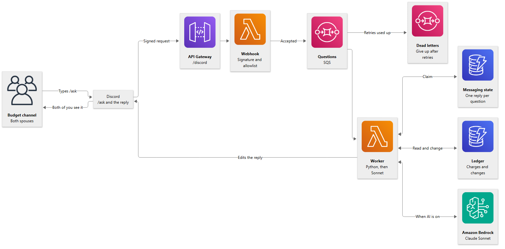
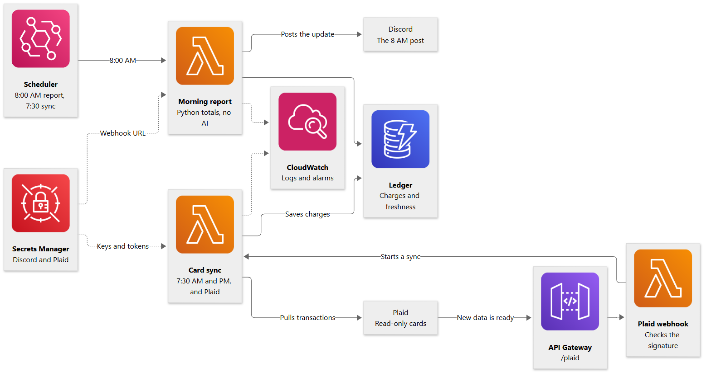
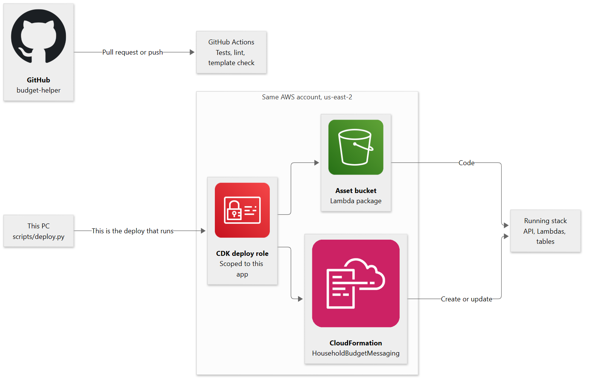

# Household budget assistant

A sample household finance bot for **one private Discord channel** shared by two people. Either person asks with `/ask` and both see the answer. The bot posts a budget update there at 8:00 AM Central every day. It combines example card transactions (through Plaid, or a CSV), a deterministic $6,280 monthly budget engine written in Python, and Claude Sonnet to interpret questions and explain the results.

This repository is a public portfolio sample. It has no bank tokens, Discord IDs, card numbers, or real transactions. The category caps and the example card names are sample data. Plaid and the model stay off until a deploy turns them on. Tests use fakes and a DynamoDB emulator, and they never call live AWS, Discord, Plaid, or Bedrock.

The morning report is Python only. Questions use the highest Claude Sonnet the AWS account can call ([decision 003](docs/decisions/003-sonnet-on-bedrock-and-plaid.md)). A short “yes” continues the previous offer.

## Start here

| Task | Guide |
|---|---|
| Run and change the code | [Development](docs/development.md) |
| Understand the modules and message lifecycle | [Architecture](docs/architecture.md) |
| Set up Discord, deploy from this PC, and go live | [Discord setup](docs/discord-setup.md) |
| Connect cards with Plaid or CSV, and turn on Claude Sonnet | [Banking and AI setup](docs/banking-and-ai-setup.md) |
| See why Discord replaced group texts | [Decision 002](docs/decisions/002-discord-channel.md) |
| See why Sonnet on Bedrock and Plaid, and what is still open | [Decision 003](docs/decisions/003-sonnet-on-bedrock-and-plaid.md) |
| See what comes next | [Roadmap](docs/roadmap.md) |

## Local quick start

Python 3.14 is the Lambda/CI target. From PowerShell at the repository root:

```powershell
python -m venv .venv
.\.venv\Scripts\python.exe -m pip install -r requirements-dev.txt
.\.venv\Scripts\python.exe scripts/check.py
```

For the full CI check, also install Node.js 24 and npm:

```powershell
npm ci
.\.venv\Scripts\python.exe scripts/check.py --synth
```

The checks use fake settings and block unmocked network calls in tests. `--synth` downloads Linux Lambda dependencies and generates a local CloudFormation template; it does not deploy. AWS credentials are not needed. See [development](docs/development.md) for individual commands and configuration.

## Repository map

```text
src/budget_bot/       Budget engine, Plaid, Claude assistant, Discord adapter, Lambda entry points
infrastructure/      Python CDK stack, scoped CloudFormation policy, GitHub OIDC role template
tests/unit/          Money and budget rules, Plaid, tools and assistant, signatures, handlers
tests/integration/   Local DynamoDB emulation, Lambda entry points, CDK template assertions
scripts/             Checks, Lambda build, Plaid linking, CSV import, ledger admin, demo, AI check
docs/                Architecture, setup guides, decisions, roadmap, and live-test instructions
.github/workflows/   GitHub Actions CI/CD
```

## Infrastructure and connections

These images show the infrastructure defined in this repository. The application targets **one AWS account and one region**. Card sync and model answers stay off until that deploy turns them on.

### A question



Discord sends a signed `/ask` to API Gateway. The webhook Lambda checks the signature, server, channel and both user IDs, queues the question, and tells Discord a reply is coming. The worker claims the question, answers `summary` and category names in Python, or asks Claude Sonnet on Bedrock when it needs to, then edits the reply in the channel.

### The morning report and the cards



EventBridge Scheduler runs the report Lambda at 8:00 AM Central. That post is Python totals only, with no model. The same schedule pulls new card transactions at 7:30 AM and 7:30 PM, and Plaid's signed webhook can start a sync sooner. Dotted arrows are credentials and logs.

### Build and deployment



Pull requests run the tests on GitHub. Deploys run from this PC, because this project cannot trust GitHub to deploy ([decision 001](docs/decisions/001-local-aws-deploy.md)).

## How Claude and credit card data fit

The path is **Plaid or CSV import → transactions in DynamoDB → Python budget calculations → Claude Sonnet interprets and explains → reply in the Discord channel**.

- **Python owns every number.** Totals, dates, categories, refunds, pace and remaining budget are Decimal arithmetic with tests. The model chooses among seventeen restricted tools and words the answer. Every dollar amount and percentage in its reply must appear verbatim in a tool result, or the plain Python summary is posted instead.
- **Highest Sonnet, automatically.** The bot calls the newest Claude Sonnet the AWS account can use, through Amazon Bedrock, and moves up on its own when a newer one is released. Run `python scripts/check_ai_access.py` to see what the account can call.
- **One previous exchange.** The bot remembers the last question and reply. “The October 9 one” finishes a listed charge choice. “Yes”, “yeah”, “sure”, or “ok” accepts the offer in that reply, such as a closer look at the categories it just flagged.
- **Corrections.** "Move that Target charge to gifts" changes one transaction, audited and undoable. Costco and Target default to Groceries and household.
- **No model for the morning post** or for plain commands like `summary` and `dining`.

The ChatGPT Finances connections cannot be reused by this app. Cards connect through Plaid (read-only) or a CSV. See the [banking and AI setup guide](docs/banking-and-ai-setup.md).

## Current limitations

- A Robinhood CSV preset is still missing because the export's header row is not known. Chase has a preset, and a generic CSV format works for other exports.
- The bot calls the highest Claude Sonnet the account can use. A newer Sonnet can be listed in Bedrock and still be unavailable to that account. See [decision 003](docs/decisions/003-sonnet-on-bedrock-and-plaid.md#open-items).
- A daily post accepted by Discord just before a timeout or crash can post twice on retry. Processing leases recover abandoned work; they do not guarantee exactly-once delivery.
- Only `/ask` is supported. Plain messages in the channel would need an always-on Discord Gateway connection.
- Optional alarms and a $50 cost budget only send email. They do not stop spending. A separate account spend limit is the hard ceiling when the account has one.
- No deployment, live message, bank link, or model call is authorized by running the local checks.

See [architecture and failure behavior](docs/architecture.md) before changing these boundaries.
